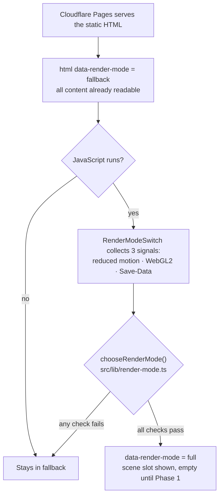

# Architecture

How the parts of halaszraymond.com v2 fit together. The concept and all decisions live in the [README](../README.md); this file explains the code. New terms are explained in the [glossary](glossary.md).

## The big picture

The site is **static**: `npm run build` turns everything in `src/` into plain HTML, CSS and JavaScript files in `dist/`. Cloudflare Pages serves those files as-is; there is no server running code per visitor. The little JavaScript there is runs in the visitor's browser and only *enhances* a page that already works without it.

## Folder structure

| Folder | What lives there |
|---|---|
| `src/pages/` | One file per URL. Astro turns each into an HTML page. |
| `src/components/` | Reusable pieces of UI (Astro components), such as the language switcher. |
| `src/content/` | Texts, projects and translations as Markdown/JSON. Changing content never means changing code. Empty until Phase 3. |
| `src/i18n/` | Everything about languages: the list of languages and the UI strings per language. |
| `src/lib/` | **Pure logic**: functions that take values and return values, with no browser or 3D code. This is what the unit tests test. |
| `src/scene/` | Everything 3D (Three.js). Empty until Phase 1. |
| `scripts/` | Small Node scripts for the build and CI, such as the bundle-size check. Pure logic for them goes in `scripts/lib/`. |
| `tests/unit/` | Vitest unit tests for `src/lib/` and `scripts/lib/`. |
| `tests/e2e/` | Playwright end-to-end tests: the built site in real browsers. |
| `docs/` | This file, the glossary and the making-of (the build log). |
| `openspec/` | Agreed specs and proposed changes (README §5.4). |

Config files in the root: `astro.config.ts` (how the site is built), `tsconfig.json` (TypeScript settings), `eslint.config.js` and `.prettierrc.json` (code checks and formatting), `vitest.config.ts` (unit tests), `.nvmrc` (Node version) and `.gitattributes` (line endings).

## Languages and URLs

The list of languages lives in one place: `src/i18n/locales.ts`. Everything else reads from it.

| URL | What it shows | Built from |
|---|---|---|
| `/nl/`, `/hu/`, `/en/` | The home page in that language | `src/pages/[locale]/index.astro`: one file, one page per language |
| `/` | The English home page, **without a redirect**, plus the language hint | `src/pages/index.astro` |
| any unknown URL | The 404 page in all three languages, with status 404 | `src/pages/404.astro` → `404.html` |

Every page has:

- `<html lang="…">` with its language;
- a **canonical** link to its own language URL (`/` points to `/en/`, so search engines see one page, not two copies);
- **hreflang** alternates to all three languages, plus `x-default` → `/` (built by `src/lib/alternates.ts`);
- the **language switcher** (`src/components/LanguageSwitcher.astro`): plain links, so it works without JavaScript.

The 404 page has no canonical or alternates and says `noindex`, so it stays out of search results.

**Texts:** `src/i18n/ui.ts` holds every interface text per language. Its type, `Record<Locale, UiStrings>`, makes the build fail when a language misses a text.

**Remembering the choice:** clicking a link marked `data-lang-choice` (the switcher, the hint) stores that language in `localStorage` under `kalman.lang` (`src/i18n/choice-storage.ts`). No cookies. If storage is blocked, nothing is remembered and everything else still works.

**The language hint on `/`:** both the Dutch and the Hungarian hint are in the HTML, hidden. A small script asks `chooseLanguageHint()` (`src/lib/language-hint.ts`) which one to show:

1. a stored choice wins: Dutch or Hungarian → that hint, English → none;
2. otherwise the browser's first *supported* language decides in the same way (`['de', 'hu']` → Hungarian, `['en', 'hu']` → none).

Dismissing the hint stores English, so it doesn't come back.

## Full mode or fallback

Every visitor gets either the **full** experience (the 3D scene, from Phase 1) or the static **fallback**. The rule from README §5.2: never a broken or empty page. So the fallback is the starting point, and full mode has to be earned.



- **The decision** is a pure function, `chooseRenderMode()` in `src/lib/render-mode.ts`, unit-tested for all 8 combinations of the three signals.
- **The browser glue** is `src/components/RenderModeSwitch.astro`: it reads `prefers-reduced-motion`, tries to create a WebGL2 context (and releases it immediately), reads `navigator.connection.saveData` (Chromium only; missing means "no"), and writes the result to `data-render-mode` on `<html>`.
- **The scene slot** is an empty `<div aria-hidden="true">`: decorative only, hidden in fallback mode. All text and links live in the HTML around it, identical in both modes. The e2e tests compare the two.
- **Still to come in Phase 1:** step 3 of README §5.2 (measuring frame time once the scene runs) and the "lite mode" switch in the footer.

## Kálmán's config

Kálmán's shape and colours come from one config: `src/scene/kalman/kalman.config.json`. It is exactly the JSON the playground's **Copy config** button produces:

```json
{ "version": 1, "values": { "bodyHeight": 1, "headSize": 1, "tieOn": false, "...": "..." } }
```

**One table drives everything.** `KALMAN_PARAMETERS` in `src/lib/kalman-config.ts` lists every parameter once: its key, group, kind (`range`, `switch` or `colour`), range, step and default. From that table come the `KalmanConfig` type, the defaults, the validation and (in the playground) the controls, so they can never disagree. Adding a parameter is one line.

| Group | Parameters | Note |
|---|---|---|
| Body | `bodyHeight`, `bodyGirth`, `bellyRoundness` | sizes are multipliers, 1 = the starting proposal |
| Head | `headSize` | |
| Bill | `billLength`, `billThickness`, `billDroop` | |
| Ear patch | `earPatchHue`, `earPatchIntensity`, `earPatchSpread` | hue limited to golden-orange (30–50°), intensity never zero |
| Facets | `faceting` | 0–3, whole steps: how many flat faces he has |
| Flippers | `flipperLength` | |
| Swim preview | `strokeAmplitude`, `strokeSpeed` | degrees, strokes per second |
| Tie | `tieOn`, `tieColour`, `tieSize` | his professional side |
| Glasses | `glassesOn`, `glassesSize` | his professional side |

The black back, the white belly and the bill stripe are **not** parameters: they are what makes him an emperor penguin, so no setting can remove them.

**Validation** (`validateConfig()`) collects every problem at once: unknown keys, missing keys, wrong types, values outside the range or off the slider's step grid. **Import** (`importConfig()`) also checks the format version, so an old or foreign file fails with a clear message. A unit test validates the config file in the repo, so a bad paste fails CI.

## npm scripts

Run them with `npm run <name>` (`npm test` works without `run`). They are defined in `package.json`, a bit like targets in a Makefile.

| Script | What it does |
|---|---|
| `dev` | Starts the development server with live reload at <http://localhost:4321>. |
| `build` | Builds the site into `dist/`. |
| `preview` | Serves the built `dist/` locally, the way Cloudflare would. |
| `lint` | ESLint (likely bugs) plus a Prettier check (formatting). Changes nothing. |
| `format` | Fixes formatting with Prettier and fixable lint problems with ESLint. |
| `typecheck` | `astro check`: the TypeScript type checker for `.ts` and `.astro` files (like mypy). |
| `test` | Runs the Vitest unit tests once. |
| `e2e` | Runs the Playwright tests against the built site. Run `npm run build` first. |

| `size` | Checks the gzipped JavaScript in `dist/` against the 50 KB budget. Run `npm run build` first. |
| `lighthouse` | Runs Lighthouse 5 times on `/`, `/nl/`, `/hu/` and `/en/` (mobile) and fails when the median is below 90 in any category. Reports land in `.lighthouse/`. Run `npm run build` first. |
| `check` | The whole chain in CI order: `lint` → `typecheck` → `test` → `build` → `size` → `e2e` → `lighthouse`. Green here means green in CI. |

On every commit, a **pre-commit hook** runs ESLint and Prettier on the files you are committing (`lint-staged`). A commit with a lint error is blocked. The full checks (type check, tests, build) run in CI.

## Tests

| Layer | Tool | Where | What it covers |
|---|---|---|---|
| Unit | Vitest | `tests/unit/` | Pure logic: language hint, render mode, alternates, bundle budget, the `_headers` parser. |
| End-to-end | Playwright | `tests/e2e/*.spec.ts` | The built site in four browsers: desktop and mobile Chromium, mobile WebKit (iPhone), desktop Firefox. Routing, switcher, hint, 404, render mode. |
| Accessibility | axe in Playwright | `tests/e2e/quality.spec.ts` | Every page in every language: zero WCAG 2.2 AA violations, no console errors. |
| Visual regression | Playwright screenshots | `tests/e2e/visual.spec.ts` | `/`, `/nl/`, `/hu/`, `/en/` at 375 and 1280 px, compared with baselines in `tests/e2e/__screenshots__/`. **CI only** (see below). |
| Performance & co | Lighthouse | `scripts/run-lighthouse.ts` | ≥ 90 (median of 5 runs) for performance, accessibility, best practices and SEO. The gate logic is unit-tested in `scripts/lib/lighthouse-scores.ts`. |
| Bundle size | own script | `scripts/check-bundle-size.ts` | ≤ 50 KB gzipped JavaScript. |

**Production headers in tests.** Astro's preview server ignores `public/_headers`. The fixture in `tests/e2e/fixtures.ts` reads that file and adds its headers to every response, so a CSP that would block our own scripts in production also fails the tests. All e2e specs import `test` from `./fixtures` instead of from `@playwright/test`.

**Visual baselines are Linux-only.** Fonts render slightly differently per operating system, so screenshots from Windows would never match those from CI. Locally the visual tests show as *skipped*. The baselines are made by the manual GitHub workflow (see CI below).

**Lighthouse scores are noisy on a busy laptop.** The performance score depends on how long the main thread is blocked, and background work on the machine (a virus scanner, other programs) counts too. That is why each page is measured 5 times, taking turns between pages, and the median counts. On the work laptop a single page can still dip; the CI result on GitHub's clean runner is the one that counts.

**Lighthouse locally** needs a Chrome. If none is installed, point it at Playwright's Chromium:

```bash
export CHROME_PATH="$LOCALAPPDATA/ms-playwright/chromium-1248/chrome-win64/chrome.exe"   # Git Bash
npm run lighthouse
```

## Security headers

`public/_headers` sets the headers Cloudflare Pages sends with every page. The file itself explains each one. The important one is the **CSP** (Content-Security-Policy): only files from our own domain may run or load, and inline scripts and styles are blocked. That is why `astro.config.ts` sets `inlineStylesheets: 'never'` and `assetsInlineLimit: 0`: Astro would otherwise put small scripts and styles straight into the HTML. HSTS deliberately leaves out `includeSubDomains`, so the `stamlijst` subdomain is never affected.

## CI (GitHub Actions)

Two workflows live in `.github/workflows/`:

| Workflow | When | What |
|---|---|---|
| `ci.yml` | Every push to every branch, and by hand | One job, in this order: `npm ci` → lint → type check → unit tests → build → bundle size → Playwright (browsers cached between runs) → Lighthouse. Uploads the Playwright report when something fails, and the Lighthouse reports always. A red run does not get merged. |
| `update-visual-baselines.yml` | Only by hand | Takes new screenshots on Linux and commits them to the branch it ran on. Use it only for an intended visual change, and look at the new images. |

**`main` is protected:** changes only arrive through a pull request whose CI `check` is green, for admins too; force-pushes and deleting `main` are blocked (Settings → Branches). No approval is needed, since this is a solo project.

**Starting a workflow by hand:** Actions → pick the workflow on the left → **Run workflow** → pick the branch. GitHub only shows that button for workflows whose file is on `main`.

**Commits made by a workflow don't start other workflows.** After the baseline workflow commits new screenshots, CI only runs again on the next push (or with CI's own "Run workflow" button).

**Dependabot** (`.github/dependabot.yml`) checks npm packages and GitHub Actions weekly and opens a pull request per update (dev dependencies grouped into one). Each PR goes through CI like any other change. Two major updates are skipped on purpose: TypeScript 7 (the lint and type-check tools don't support it yet) and `@types/node` beyond 24 (the types must match the Node version in `.nvmrc`; update both together).

## Hosting (Cloudflare Pages)

The site is the Cloudflare Pages project **`halaszraymond`**, connected to this GitHub repo with Cloudflare's Git integration. Cloudflare builds on every push itself; no deploy secrets live in GitHub.

| Setting | Value |
|---|---|
| Production branch | `main` → `halaszraymond.pages.dev` (and `halaszraymond.com` from go-live) |
| Other branches | Each gets a preview: `<branch-name>.halaszraymond.pages.dev`, e.g. `change-phase-0-setup.halaszraymond.pages.dev` (slashes become dashes) |
| Build command | `npm run build` |
| Build output directory | `dist` |
| Node version | From `.nvmrc` (not a dashboard variable), so it is versioned with the code |
| Custom domain | None until go-live (README §6) |

Cloudflare reads `public/_headers` from the build output: the build log says `Parsed 1 valid header rule`. It serves `404.html` with status 404 for unknown URLs.

**Setting it up again from scratch** (e.g. a new account):

1. Dashboard → **Compute** → **Workers & Pages** → **Create application** → the **Pages** tab (not Workers: the Workers form asks for a *Deploy command*) → **Import an existing Git repository**.
2. Connect GitHub; allow the Cloudflare app on **Only select repositories** → `portfolio_site`.
3. Project name `halaszraymond`, production branch `main`, build command `npm run build`, output directory `dist`. No environment variables needed.
4. Settings → Builds → Branch control: preview branches = **All non-Production branches**.
5. Don't add a custom domain before go-live.

## Development on a work network

Zscaler on the work network inspects HTTPS traffic with its own certificate. Windows trusts it, but Node does not by default, so `npm install` fails with `UNABLE_TO_GET_ISSUER_CERT_LOCALLY`. The fix is to let Node use the Windows certificate store: set the environment variable `NODE_USE_SYSTEM_CA=1`. Never turn off certificate checks (`strict-ssl=false`) instead.

Zscaler also blocks `*.pages.dev`, so preview deployments can't be opened on the work laptop: check them on a phone or at home. And Astro's anonymous telemetry hangs for ~40 s on this network; the test scripts switch it off. For your own `npm run dev`, run `npx astro telemetry disable` once.
