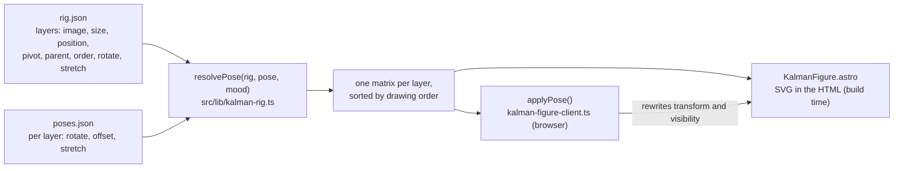
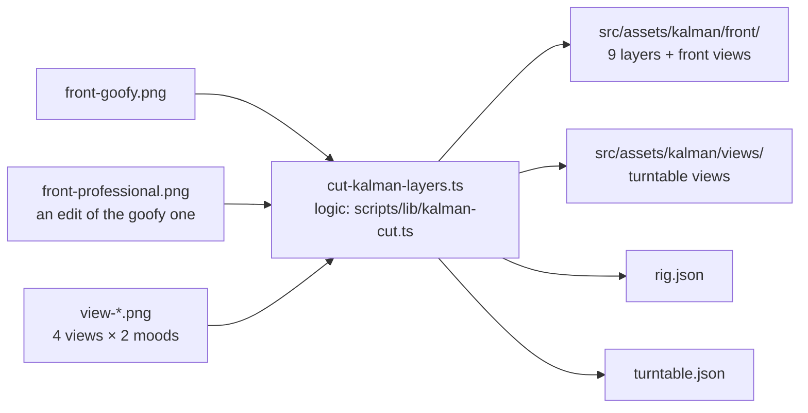
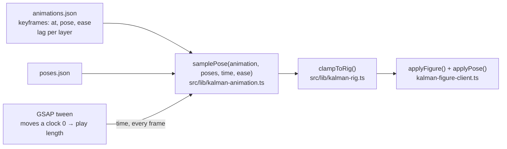

# Architecture

How the parts of halaszraymond.com v2 fit together. The concept and all decisions live in the [README](../README.md); this file explains the code. New terms are explained in the [glossary](glossary.md).

## The big picture

The site is **static**: `npm run build` turns everything in `src/` into plain HTML, CSS and JavaScript files in `dist/`. Cloudflare Pages serves those files as-is; there is no server running code per visitor. The little JavaScript there is runs in the visitor's browser and only *enhances* a page that already works without it.

## Folder structure

| Folder | What lives there |
|---|---|
| `src/pages/` | One file per URL. Astro turns each into an HTML page. |
| `src/components/` | Reusable pieces of UI (Astro components), such as the language switcher. |
| `src/content/` | Texts, projects and translations as Markdown/JSON. Changing content never means changing code. Empty until Phase 3. |
| `src/i18n/` | Everything about languages: the list of languages and the UI strings per language. |
| `src/lib/` | **Pure logic**: functions that take values and return values, with no browser or drawing code. This is what the unit tests test. |
| `src/scene/` | Everything animated, in 2D. For now Kálmán's figure: his rig, poses and SVG component (`src/scene/kalman/`). |
| `src/assets/` | Images that go through Astro's build (hashed file names). For now Kálmán's layers, `src/assets/kalman/`. |
| `src/playground/` | The dev-only Kálmán preview at `/playground/` (see below). Not in `src/pages/`, so it is only added when the flag says so. |
| `scripts/` | Small Node scripts for the build and CI, such as the bundle-size check. Pure logic for them goes in `scripts/lib/`. |
| `tests/unit/` | Vitest unit tests for `src/lib/` and `scripts/lib/`. |
| `tests/e2e/` | Playwright end-to-end tests: the built site in real browsers. |
| `docs/` | This file, the glossary, the making-of (the build log) and Kálmán's layer guide (`kalman-layers.md`). |
| `openspec/` | Agreed specs and proposed changes (README §5.4). |

Config files in the root: `astro.config.ts` (how the site is built), `tsconfig.json` (TypeScript settings), `eslint.config.js` and `.prettierrc.json` (code checks and formatting), `vitest.config.ts` (unit tests), `.nvmrc` (Node version) and `.gitattributes` (line endings).

## Languages and URLs

The list of languages lives in one place: `src/i18n/locales.ts`. Everything else reads from it.

| URL | What it shows | Built from |
|---|---|---|
| `/nl/`, `/hu/`, `/en/` | The home page in that language | `src/pages/[locale]/index.astro`: one file, one page per language |
| `/` | The English home page, **without a redirect**, plus the language hint | `src/pages/index.astro` |
| any unknown URL | The 404 page in all three languages, with status 404 | `src/pages/404.astro` → `404.html` |

Every page has:

- `<html lang="…">` with its language;
- a **canonical** link to its own language URL (`/` points to `/en/`, so search engines see one page, not two copies);
- **hreflang** alternates to all three languages, plus `x-default` → `/` (built by `src/lib/alternates.ts`);
- the **language switcher** (`src/components/LanguageSwitcher.astro`): plain links, so it works without JavaScript.

The 404 page has no canonical or alternates and says `noindex`, so it stays out of search results. The same goes for the dev-only preview, which also has no language switcher.

**Texts:** `src/i18n/ui.ts` holds every interface text per language. Its type, `Record<Locale, UiStrings>`, makes the build fail when a language misses a text.

**Remembering the choice:** clicking a link marked `data-lang-choice` (the switcher, the hint) stores that language in `localStorage` under `kalman.lang` (`src/i18n/choice-storage.ts`). No cookies. If storage is blocked, nothing is remembered and everything else still works.

**The language hint on `/`:** both the Dutch and the Hungarian hint are in the HTML, hidden. A small script asks `chooseLanguageHint()` (`src/lib/language-hint.ts`) which one to show:

1. a stored choice wins: Dutch or Hungarian → that hint, English → none;
2. otherwise the browser's first *supported* language decides in the same way (`['de', 'hu']` → Hungarian, `['en', 'hu']` → none).

Dismissing the hint stores English, so it doesn't come back.

## Full mode or fallback

Every visitor gets either the **full** experience (the animated scene, from Phase 2) or the static **fallback**. The rule from README §5.2: never a broken or empty page. So the fallback is the starting point, and full mode has to be earned.


- **The decision** is a pure function, `chooseRenderMode()` in `src/lib/render-mode.ts`, unit-tested for all 4 combinations of the two signals.
- **The browser glue** is `src/components/RenderModeSwitch.astro`: it reads `prefers-reduced-motion` and `navigator.connection.saveData` (Chromium only; missing means "no"), and writes the result to `data-render-mode` on `<html>`.
- **No WebGL check.** The site is 2D (images, SVG and canvas 2D), so a browser without WebGL can run the full mode. That check was removed in Phase 1.
- **The scene slot** is an empty `<div aria-hidden="true">`: decorative only, hidden in fallback mode. All text and links live in the HTML around it, identical in both modes. The e2e tests compare the two.
- **Still to come:** step 3 of README §5.2 (measuring frame time once the animated scene runs) and the "lite mode" switch in the footer.

## Kálmán: rig, poses and figure

Kálmán is a **cut-out figure**: flat images (layers) moved like a paper puppet, in two **figures**: the front (nine layers) and the side (eight layers, for diving and swimming). Where they sit and how they move is data, not code; the maths is pure functions; the browser only applies the result.



- **Two figures.** `rig.json` holds a rig per figure (`{ "front": …, "side": … }`), on the same artboard and placement, so switching doesn't make him jump; every pose says its `figure`. The SVG has a `<g data-layers data-figure>` per figure, and `applyFigure()` shows one of them.
- **The rig** (`src/scene/kalman/rig.json`) places every layer on a 1600 × 1500 **artboard**. Positions are absolute artboard coordinates, so they can be read off the design sheet; pivots are in the image's own coordinates. `docs/kalman-layers.md` explains every field.
- **Poses** (`src/scene/kalman/poses.json`) only store differences from rest: rotation around the pivot, an offset, and a **stretch** (squash and stretch: 0.9 is 10% shorter and correspondingly wider, so the area stays the same). Layers a pose doesn't mention stay at rest. The rig limits each layer's rotation (`rotate`) and, for the layers that may stretch (bodies and heads), its stretch (`stretch`); `clampToRig()` keeps a pose inside those limits.
- **`resolvePose()`** turns rig + pose + mood into one SVG transform matrix per layer: stretch around the pivot, turn around it, then move. A child gets its own movement plus its parent's *movement from rest*, stretch included, so the glasses follow the head, everything follows the body, and when the body squashes the head stays on the neck. The tie and the glasses are `accessory` layers: hidden in the goofy mood.
- **Flat, not nested.** The SVG has one `<g>` per layer, sorted by `order`. Nested groups would let the browser combine the transforms, but in SVG a child is always drawn in front of its parent, and the far flipper must be able to sit behind the body.
- **Validation.** `validateRig()` and `validatePose()` list every problem at once: unknown parents, loops, a shared drawing order, missing images, rotations outside a layer's range. `src/scene/kalman/repo-rig.ts` validates the repo's files when they are loaded (so the build fails on a bad edit), and `tests/unit/kalman-rig-data.test.ts` checks them in CI.
- **Images.** `KalmanFigure.astro` looks every layer's image up in `src/assets/kalman/` with `import.meta.glob`, so Astro gives it a hashed file name; a missing file fails the build. They are cut from Raymond's design images by a script (see below), into `src/assets/kalman/front/`.
- **Without JavaScript** the figure is already in the HTML, in the rest pose. The fallback stills later are this same component with another pose.
- **Spinning:** all layers sit in one `<g data-spin>` group, which `spinMatrix()` turns around `figureCentre()` (the middle of the figure at rest). It is a view setting, not part of a pose.

### Where the layers come from

Raymond makes the images with Gemini (`docs/images/kalman-design/`, explained in [`kalman-layers.md`](kalman-layers.md)); `npm run cut:kalman` (`scripts/cut-kalman-layers.ts`) cuts them:



- **Background:** a flood fill from the edges through near-white pixels; the outline gets a soft edge from how far a pixel is from white.
- **Tie and glasses:** the professional front view is an edit of the goofy one, so they line up pixel for pixel; where they differ (within the area of the tie and of the glasses) is the tie and glasses layers. The script refuses images of different sizes.
- **The parts:** the flippers are cut at the gap Gemini drew between flipper and body, found row by row; above it along the shoulder. Body and flipper share no pixel below the gap (a shared column would show as a line when the flipper turns), and above it the flipper reaches 2 px under the body to hide the seam. The head fades into the neck.
- **The side figure** comes from three images: `side-goofy.png`, its professional edit, and an edit without the near flipper. The body is cut from the flipper-less one, so a swinging flipper shows painted body underneath; the flipper lies on the body, so it is cut along an outline traced once in the script's settings (`polygonCoverage()`).
- **Reproducible:** the same images always give the same files. The cut lines are in one settings object at the top of the script; all decisions are tested functions in `scripts/lib/kalman-cut.ts`. It uses `sharp` (the image library Astro already uses, declared as a devDependency).

### Turning around: the turntable

`turntable.json` lists views by angle: the front (0°), four drawn views (¾ front 45°, side 90°, ¾ back 135°, back 180°) and three mirrored ones (225°, 270°, 315°), which borrow a drawn view's image flipped (`mirrorOf`). The script matches every view's plumage tone, ground line and body centre to the front view.

- `turntableFrame()` (`src/lib/kalman-turntable.ts`) decides what shows at an angle: exactly the drawing at a view's own angle; in between, the current view narrows and, over a short band halfway, the next one fades in **on top** while the outgoing one stays solid, so the background never shows through.
- `applyTurn()` shows the posable layers only at exactly 0° and the views at any other angle. Whole groups are hidden with `display`, not `visibility`: an SVG child that says `visibility="visible"` would still show inside a hidden group.
- The preview's control is a "Turn around" slider plus dragging sideways on the figure; it is left out while `turntable.json` has only one view.

### Animations

The six animations (idle, bow, head-follow, dive, swim, launch) are keyframes of poses in `src/scene/kalman/animations.json`: a pose at a moment, with an easing towards the next one.



- **GSAP is only the clock.** `kalman-player.ts` makes one tween of a plain `time` value per animation; on every frame `samplePose()` blends the two keyframes around that time (through GSAP's easing curve, `gsap.parseEase`) and `applyPose()` draws it. So the poses and timing are data, and the maths is tested without GSAP.
- **Lag is a time shift.** An animation may give layers a `lag` in seconds: such a layer takes its values from the pose `lag` seconds earlier, so the head leads and the tail and feet trail behind and settle later (follow-through and overlap). In a loop that earlier moment wraps around into the previous round. It is still a pure function of time, so a scrubbed moment looks exactly like a played one; a spring would depend on the previous frames.
- **Play length.** A non-looping animation plays until its slowest layer has caught up: the last keyframe plus the largest lag (`playLength()`). The tween, the scrub slider and "finished" all use it. A loop keeps its keyframe length.
- **Overshoot, clamped.** The `back` easings go slightly past the target and settle back. Every sampled pose goes through `clampToRig()` before it is drawn, so no layer turns or stretches past its range.
- **One at a time.** Starting an animation stops the previous one; a non-looping one ends with him at rest. The figure carries `data-animation` and `data-time`, which the preview and the tests read.
- **Scrubbing** pauses the tween and sets its progress; **a hidden tab** pauses it (`visibilitychange`) and continues it when visible again.
- **Head-follow** turns the front figure's head towards the pointer: `headTurn()` gives the angle from how far the pointer is to the side, and `gsap.quickTo` glides the head there.
- **Reduced motion:** nothing starts by itself; an animation only plays when it is explicitly started.

## The dev-only Kálmán preview

`/playground/` is where Raymond looks at Kálmán's poses, tries new ones with a slider per layer, and copies a pose as JSON for `poses.json`. While it is dev-only, it must never reach production, but it must work on his laptop, in CI and on Cloudflare branch previews (so he can use it on his phone).

**How:** the page lives in `src/playground/PreviewPage.astro`, not in `src/pages/`. A small integration in `astro.config.ts` adds it as a route only when `shouldIncludePlayground()` (`src/lib/playground-flag.ts`) says so:

| Where | Command | Preview? |
|---|---|---|
| Your laptop | `npm run dev` | yes, always |
| Your laptop | `npm run build` | no |
| Your laptop | `npm run build:playground` | yes (sets `PLAYGROUND=1` from `.env.playground`) |
| CI | production build, then playground build | first no (checked), then yes (tested) |
| Cloudflare branch previews | `npm run build` with the **Preview** variable `PLAYGROUND=1` | yes |
| Cloudflare production (`main`) | `npm run build`, no variable | no |

Only exactly `PLAYGROUND=1` switches it on, so a typo never leaks it.

**The proof:** `npm run check:production` (after `npm run build`) fails if `dist/` has a `playground` folder or any HTML or JavaScript containing the preview's marker `kalman-preview`. The search is a pure function in `scripts/lib/production-check.ts`. Kálmán's figure and rig code are not preview code (the hero will use them), so the check doesn't look for them.

**The page:** a play button per animation, the idle loop switch (on by default, off with reduced motion) and a scrub slider; a front/side switch; pose buttons (`aria-pressed`) and one slider per layer (limited to its `rotate` range) for the chosen figure; a switch for the professional mood, a switch for the pivot markers, the turn-around (front figure) and spin sliders; and **Copy pose** (with the pose's figure). All controls are plain HTML, built from `rig.json`, `poses.json` and `animations.json` at build time (`PreviewControls.astro`). The browser script `preview-client.ts` keeps the state; the logic of "named pose + slider changes = custom pose" is a pure function in `src/lib/preview-pose.ts`. If the clipboard is refused, the JSON is still in a text box to copy by hand. English only (`src/i18n/preview.ts`) while it is dev-only, `noindex`, and no public page links to it.

**Cloudflare setup:** Pages project → Settings → Variables and Secrets → `PLAYGROUND` = `1`, for the **Preview** environment only. If it is ever missing, `/playground/` simply 404s on previews; nothing leaks.

## npm scripts

Run them with `npm run <name>` (`npm test` works without `run`). They are defined in `package.json`, a bit like targets in a Makefile.

| Script | What it does |
|---|---|
| `dev` | Starts the development server with live reload at <http://localhost:4321>. |
| `build` | Builds the production site into `dist/` (without the preview). |
| `build:playground` | Builds the site including the dev-only preview (`PLAYGROUND=1`). |
| `check:production` | After `build`: fails if the preview ended up in `dist/`. |
| `cut:kalman` | Cuts Kálmán's layers and turntable views from the images in `docs/images/kalman-design/` and writes `rig.json` and `turntable.json` (see `docs/kalman-layers.md`). |
| `check:kalman` | Runs `cut:kalman` and fails if that changes any committed file: the generated images must match their sources. Also a CI step. |
| `preview` | Serves the built `dist/` locally, the way Cloudflare would. |
| `lint` | ESLint (likely bugs) plus a Prettier check (formatting). Changes nothing. |
| `format` | Fixes formatting with Prettier and fixable lint problems with ESLint. |
| `typecheck` | `astro check`: the TypeScript type checker for `.ts` and `.astro` files (like mypy). |
| `test` | Runs the Vitest unit tests once. |
| `e2e` | Runs the Playwright tests against the built site. Run `npm run build:playground` first (the preview tests need it). |
| `size` | Checks the JavaScript each page loads (its scripts plus everything they import), gzipped, against that page's budget: 50 KB for every page for now. Run a build first. |
| `lighthouse` | Runs Lighthouse 5 times on `/`, `/nl/`, `/hu/` and `/en/` (mobile) and fails when the median is below 90 in any category. Reports land in `.lighthouse/`. Run `npm run build` first. |
| `check` | The whole chain in CI order: `lint` → `typecheck` → `test` → `check:kalman` → `build` → `check:production` → `build:playground` → `size` → `e2e` → `lighthouse`. Green here means green in CI. |

On every commit, a **pre-commit hook** runs ESLint and Prettier on the files you are committing (`lint-staged`). A commit with a lint error is blocked. The full checks (type check, tests, build) run in CI.

## Tests

| Layer | Tool | Where | What it covers |
|---|---|---|---|
| Unit | Vitest | `tests/unit/` | Pure logic: language hint, render mode, alternates, budgets and the chunk graph, the `_headers` parser, the preview flag and production check, Kálmán's rig maths and validation, the cutting logic, the turntable maths and validation, the preview's pose logic, and the repo's `rig.json`, `poses.json` and `turntable.json`. |
| End-to-end | Playwright | `tests/e2e/*.spec.ts` | The built site in four browsers: desktop and mobile Chromium, mobile WebKit (iPhone), desktop Firefox. Routing, switcher, hint, 404, render mode, and the Kálmán preview (poses, sliders, mood, pivots, spin, turning around, Copy pose, no JavaScript, 360 px). |
| Accessibility | axe in Playwright | `tests/e2e/quality.spec.ts` | Every page in every language, and the preview: zero WCAG 2.2 AA violations, no console errors. |
| Visual regression | Playwright screenshots | `tests/e2e/visual.spec.ts` | `/`, `/nl/`, `/hu/`, `/en/` at 375 and 1280 px, plus two of Kálmán's poses in the preview (rest goofy, bow professional), compared with baselines in `tests/e2e/__screenshots__/`. **CI only** (see below). |
| Performance & co | Lighthouse | `scripts/run-lighthouse.ts` | ≥ 90 (median of 5 runs) for performance, accessibility, best practices and SEO. The gate logic is unit-tested in `scripts/lib/lighthouse-scores.ts`. |
| Bundle size | own script | `scripts/check-bundle-size.ts` | Per page: ≤ 50 KB gzipped JavaScript. |
| Production | own script | `scripts/check-production-build.ts` | The production build contains no preview page or code. |

**Production headers in tests.** Astro's preview server ignores `public/_headers`. The fixture in `tests/e2e/fixtures.ts` reads that file and adds its headers to every response, so a CSP that would block our own scripts in production also fails the tests. All e2e specs import `test` from `./fixtures` instead of from `@playwright/test`.

**Visual baselines are Linux-only.** Fonts render slightly differently per operating system, so screenshots from Windows would never match those from CI. Locally the visual tests show as *skipped*. The baselines are made by the manual GitHub workflow (see CI below).

**Lighthouse scores are noisy on a busy laptop.** The performance score depends on how long the main thread is blocked, and background work on the machine (a virus scanner, other programs) counts too. That is why each page is measured 5 times, taking turns between pages, and the median counts. On the work laptop a single page can still dip; the CI result on GitHub's clean runner is the one that counts.

**Lighthouse locally** needs a Chrome. If none is installed, point it at Playwright's Chromium:

```bash
export CHROME_PATH="$LOCALAPPDATA/ms-playwright/chromium-1248/chrome-win64/chrome.exe"   # Git Bash
npm run lighthouse
```

## Security headers

`public/_headers` sets the headers Cloudflare Pages sends with every page. The file itself explains each one. The important one is the **CSP** (Content-Security-Policy): only files from our own domain may run or load, and inline scripts and styles are blocked. That is why `astro.config.ts` sets `inlineStylesheets: 'never'` and `assetsInlineLimit: 0`: Astro would otherwise put small scripts and styles straight into the HTML. HSTS deliberately leaves out `includeSubDomains`, so the `stamlijst` subdomain is never affected.

## CI (GitHub Actions)

Two workflows live in `.github/workflows/`:

| Workflow | When | What |
|---|---|---|
| `ci.yml` | Every push to every branch, and by hand | One job, in this order: `npm ci` → lint → type check → unit tests → Kálmán images up to date → production build → production check → playground build → bundle size per page → Playwright (browsers cached between runs) → Lighthouse. Uploads the Playwright report when something fails, and the Lighthouse reports always. A red run does not get merged. |
| `update-visual-baselines.yml` | Only by hand | Builds with the preview, takes new screenshots on Linux and commits them to the branch it ran on. Use it only for an intended visual change, and look at the new images. |

**`main` is protected:** changes only arrive through a pull request whose CI `check` is green, for admins too; force-pushes and deleting `main` are blocked (Settings → Branches). No approval is needed, since this is a solo project.

**Starting a workflow by hand:** Actions → pick the workflow on the left → **Run workflow** → pick the branch. GitHub only shows that button for workflows whose file is on `main`.

**Commits made by a workflow don't start other workflows.** After the baseline workflow commits new screenshots, CI only runs again on the next push (or with CI's own "Run workflow" button).

**Dependabot** (`.github/dependabot.yml`) checks npm packages and GitHub Actions weekly and opens a pull request per update (dev dependencies grouped into one). Each PR goes through CI like any other change. Two major updates are skipped on purpose: TypeScript 7 (the lint and type-check tools don't support it yet) and `@types/node` beyond 24 (the types must match the Node version in `.nvmrc`; update both together).

## Hosting (Cloudflare Pages)

The site is the Cloudflare Pages project **`halaszraymond`**, connected to this GitHub repo with Cloudflare's Git integration. Cloudflare builds on every push itself; no deploy secrets live in GitHub.

| Setting | Value |
|---|---|
| Production branch | `main` → `halaszraymond.pages.dev` (and `halaszraymond.com` from go-live) |
| Other branches | Each gets a preview: `<branch-name>.halaszraymond.pages.dev`, e.g. `change-phase-0-setup.halaszraymond.pages.dev` (slashes become dashes) |
| Build command | `npm run build` |
| Build output directory | `dist` |
| Node version | From `.nvmrc` (not a dashboard variable), so it is versioned with the code |
| Custom domain | None until go-live (README §6) |

Cloudflare reads `public/_headers` from the build output: the build log says `Parsed 1 valid header rule`. It serves `404.html` with status 404 for unknown URLs.

**Setting it up again from scratch** (e.g. a new account):

1. Dashboard → **Compute** → **Workers & Pages** → **Create application** → the **Pages** tab (not Workers: the Workers form asks for a *Deploy command*) → **Import an existing Git repository**.
2. Connect GitHub; allow the Cloudflare app on **Only select repositories** → `portfolio_site`.
3. Project name `halaszraymond`, production branch `main`, build command `npm run build`, output directory `dist`. One environment variable, for **Preview** only: `PLAYGROUND` = `1` (see the preview section).
4. Settings → Builds → Branch control: preview branches = **All non-Production branches**.
5. Don't add a custom domain before go-live.

## Development on a work network

Zscaler on the work network inspects HTTPS traffic with its own certificate. Windows trusts it, but Node does not by default, so `npm install` fails with `UNABLE_TO_GET_ISSUER_CERT_LOCALLY`. The fix is to let Node use the Windows certificate store: set the environment variable `NODE_USE_SYSTEM_CA=1`. Never turn off certificate checks (`strict-ssl=false`) instead.

Astro allows only one preview server per project: if `npm run e2e` says the web server couldn't start, an old `astro preview` is still running; `npx astro preview stop` ends it.

Zscaler also blocks `*.pages.dev`, so preview deployments can't be opened on the work laptop: check them on a phone or at home. And Astro's anonymous telemetry hangs for ~40 s on this network; the test scripts switch it off. For your own `npm run dev`, run `npx astro telemetry disable` once.
