# Making of halaszraymond.com v2

The build log of this site: what was decided, what was built, and what went wrong along the way. It is the raw material for the "this website" case study (README §4). Every decision is also listed, one line each, in [PLANNING_LOG.md](../PLANNING_LOG.md).

---

## 2026-10-25 · The concept and Phase 0

### The concept

The idea comes from two surnames. *Visser* (Dutch) and *Halász* (Hungarian) both mean "fisherman", and Raymond fishes patterns out of data. The emperor penguin is the deepest-diving bird in the world, so the site became **one dive**: scrolling is diving, a depth gauge doubles as navigation, and the bottom is at **564 m**, the record dive of an emperor penguin (verified via Guinness World Records). The guide is an original low-poly penguin: **Keizer Kálmán** in Dutch, **Császár Kálmán** in Hungarian (name order as in *Halász Raymond*) and **Emperor Kálmán** in English. He is named after Rudolf Kálmán, whose Kalman filter estimates where something moves from noisy data, which is exactly what a hunting penguin does.

Before writing any code, a long README review settled the hard questions:

- **The hero has to work for a recruiter in five seconds**: a "catch of the day" board with the key facts, and Kálmán holding the CV in his bill.
- **Kálmán has two personalities**, goofy and professional (tie and reading glasses), switched by what the visitor does. The rule: humour in the wrapping, seriousness in the content.
- **Never a broken page**: a static fallback for reduced motion, missing WebGL2, Save-Data or slow devices.
- **Quality is enforced, not hoped for**: Lighthouse ≥ 90, accessibility checks, visual regression, performance budgets, all in CI from day 1.
- **The site email became `raymond@halaszraymond.com`**, not `kalman@…`: otherwise visitors might think the penguin's name is Raymond's.

### Planning Phase 0 with OpenSpec

Every feature is first written down as an OpenSpec change: a proposal (why), specs (what, as testable scenarios), a design (how) and tasks. Raymond reviews it before anything is built. Phase 0 became one change, `phase-0-setup`, with two capabilities: **i18n-routing** (which URL shows which language) and **render-fallback** (3D or static). Each spec scenario, such as "WHEN a visitor with a Hungarian browser opens `/` THEN a Hungarian hint appears", became an automated test.

### What was built

A site with no content yet, but with the skeleton everything else will stand on:

| Dutch | Hungarian | English |
|---|---|---|
| 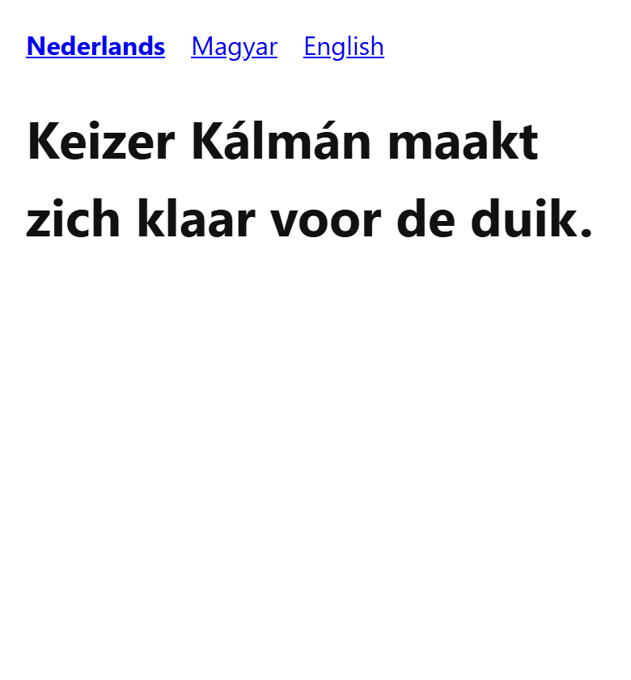 | 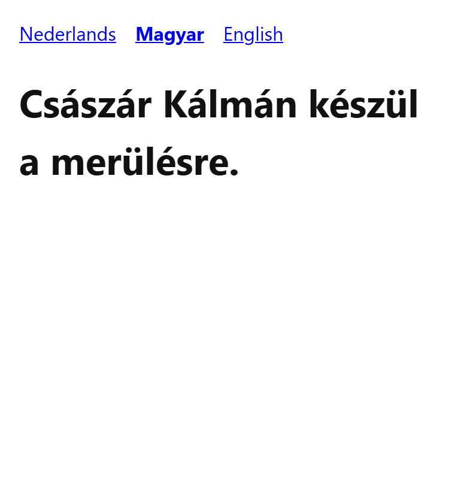 | 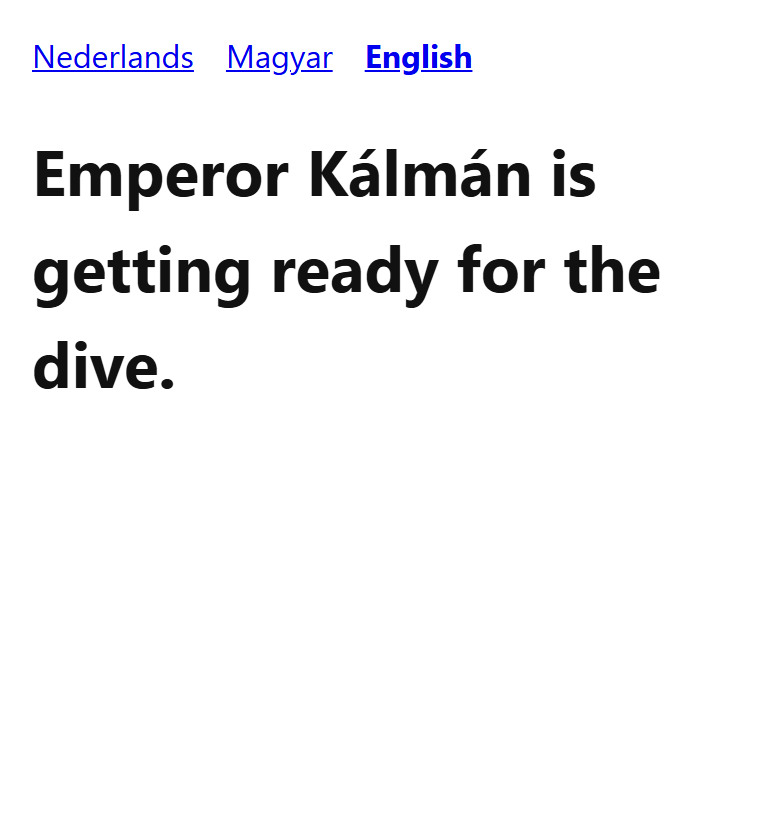 |

- **Three languages** at `/nl/`, `/hu/`, `/en/`; `/` shows English **without redirecting**, with canonical and hreflang links for search engines.
- **A language hint** on `/` for Dutch and Hungarian browsers, written in the language it offers. The choice is remembered in the browser, without cookies.
- **A real 404** in all three languages (Kálmán's ice floe follows in Phase 5).

| The hint for a Hungarian browser | The 404 |
|---|---|
| 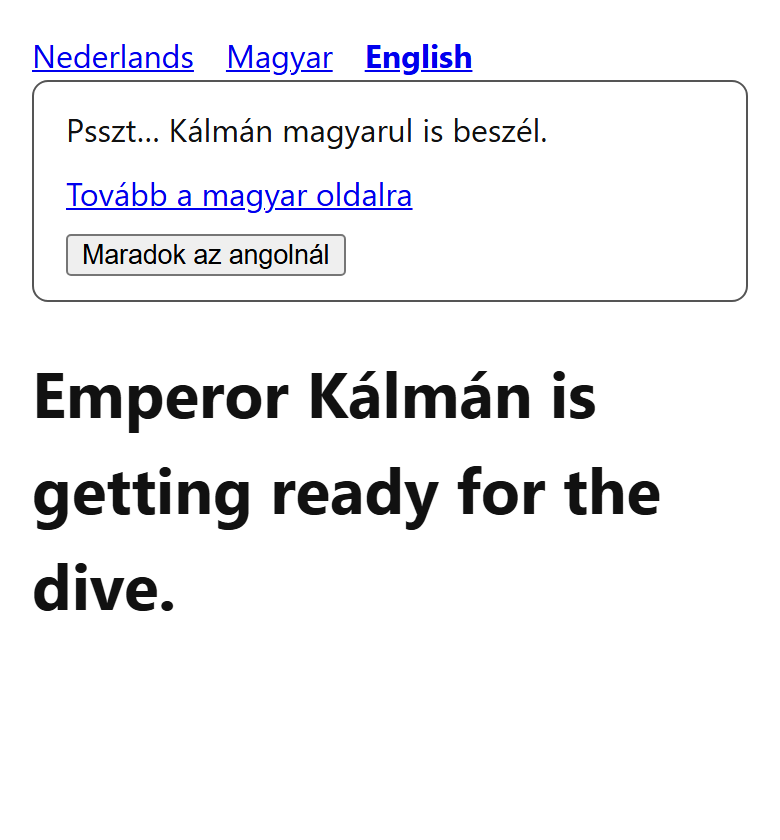 | 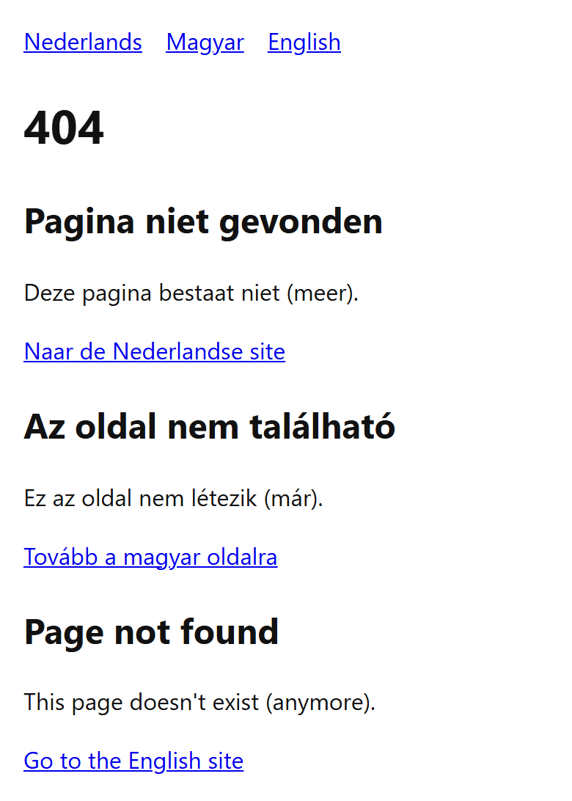 |

- **Fallback first**: every page is built as finished HTML in fallback mode. A 1 KB script switches to full mode only when there is no reduced-motion setting, WebGL2 works and Save-Data is off. The decision is a pure function, tested for all 8 combinations.
- **The quality chain**, in CI on every push: lint → type check → 43 unit tests → build → bundle budget (**1.0 KB** of JavaScript, budget 50 KB) → **162 end-to-end tests** in four browsers (desktop and mobile Chromium, iPhone WebKit, Firefox), with axe accessibility checks and the production security headers → 8 visual baselines → Lighthouse (**98–100** in all four categories).
- **Hosting** on Cloudflare Pages, with a preview URL for every branch.

### What went wrong, and what it taught us

- **The work laptop sits behind Zscaler**, which re-signs all HTTPS traffic. Node didn't trust it, so `npm install` failed. Fix: `NODE_USE_SYSTEM_CA=1` lets Node use the Windows certificate store, instead of the common but dangerous "turn off certificate checks".
- **TypeScript 7 was too new.** The lint and Astro tools didn't support it yet, so the site uses TypeScript 6 for now.
- **Astro inlined small scripts** into the HTML, which the strict security policy (CSP) would block in production. Astro now loads everything as separate files, and a test proves that an inline script would fail the build.
- **The first Cloudflare project was accidentally a Worker**, not a Pages project. The dashboard steers new projects towards Workers; the tell was a field asking for a "deploy command".
- **Lighthouse CI (`@lhci/cli`) turned out to be abandoned**, with 16 known vulnerabilities in old dependencies. It was replaced by Lighthouse itself plus a 60-line gate script of our own, with 0 vulnerabilities.
- **Lighthouse scores jumped between 83 and 100** for the same page on the laptop: background load, not the site. The gate now measures each page five times, taking turns between pages, and uses the median, without lowering the bar of 90.
- **Astro's telemetry hung for 40 seconds** on the work network before the preview server started. It is switched off for test servers.
- **GitHub only offers "Run workflow"** for workflows on the main branch, so the visual-baseline workflow went to `main` first.

---

## 2026-10-25 · Phase 1 begins: the Kálmán playground

### The plan

Kálmán's look can't be decided on paper, so Phase 1 starts with a **playground**: Kálmán drawn live in 3D, with a slider for every part of his shape. Raymond plays until he feels right and copies the config; that config becomes the one file every later scene builds on. The OpenSpec change `kalman-playground` covered three specs: `kalman-config` (what may vary and within which limits), `kalman-playground` (the page), and two small clarifications in `i18n-routing` that this work brought to light.

Four choices were Raymond's: the animations come in a later change; the playground is **dev-only** (local, CI and branch previews, never production); its interface is English until it becomes the public `/playground/`; and the chosen values travel as JSON via a "Copy config" button.

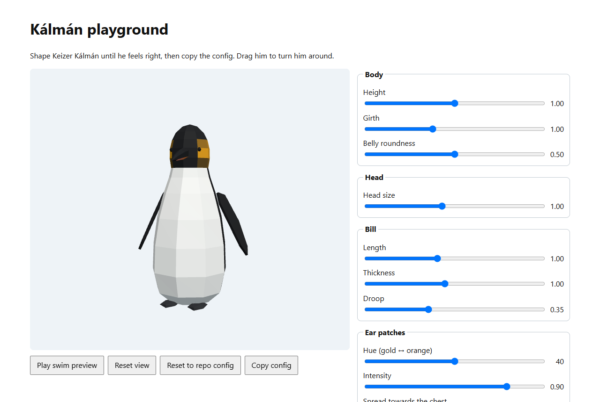

### How Kálmán is built

- **One table of parameters** (height, girth, belly, head, bill, ear patch, faceting, flippers, swim, tie, glasses) drives the config type, the validation, the defaults and the sliders. The black, the white and the bill stripe are deliberately *not* parameters: no setting can stop him being an emperor penguin, and a test checks that at the extreme settings.
- **Body and head are one "lathe"**: a side silhouette spun around the vertical axis with few segments, which gives the faceted low-poly look. Every facet gets one flat colour.
- All the numbers live in pure functions (`kalman-shape.ts`), so they are unit-tested without a browser; Three.js only draws them.

| Default | Professional side | From the side |
|---|---|---|
| 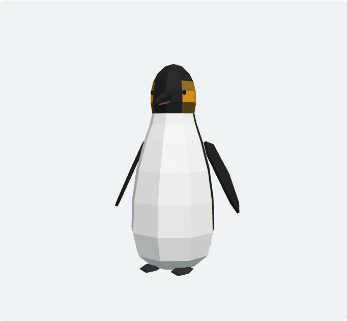 | 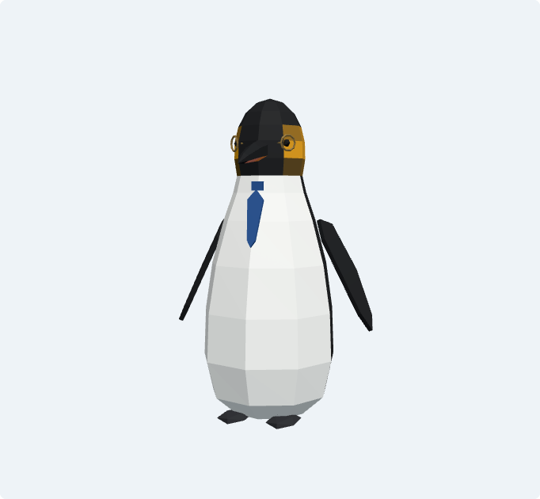 | 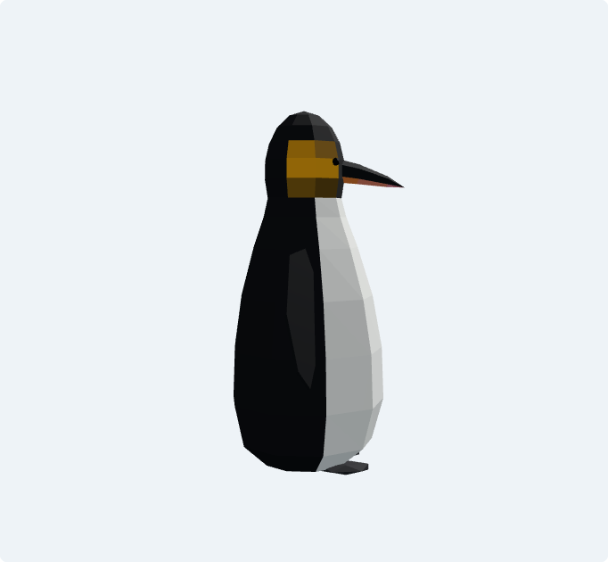 |

| Faceting 0 | Faceting 3 |
|---|---|
| 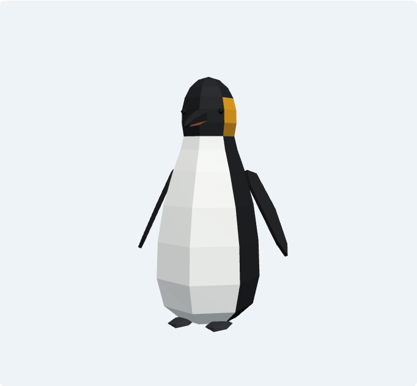 | 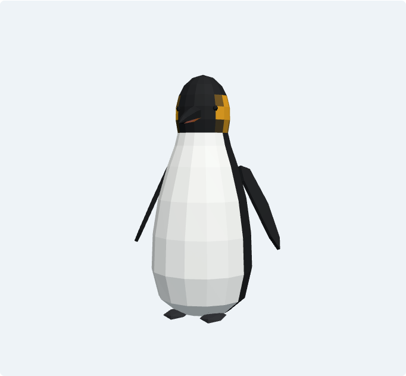 |

### What went wrong, and what it taught us

- **The first Kálmán was a snowman.** Technically everything worked, but he read as an egg with a ball on top: far too wide, flippers buried inside the belly, a bill pointing straight at the camera like a little smile, barely visible ear patches. Looking at a screenshot before showing anyone was worth it. The fixes: emperor proportions (about 0.42 wide for 1 tall), flippers that compute how far to swing out to clear the belly, a black throat (real emperors have one; Tux doesn't), a longer bill, a slightly sideways camera, and a sharper ear patch.
- **Colour per triangle gave a saw-tooth belly edge**, because each facet is two triangles that could get different colours. Colouring per facet fixed it. A facet that flipped between black and white row by row turned out to sit exactly on the belly's 60° edge; moving the edge to 69° keeps it away from every facet centre.
- **Three.js computes in linear light**, so the sRGB plumage colours have to be converted, or his black renders grey.
- **Keeping the playground off production** turned into a small Astro integration that only adds the route with `PLAYGROUND=1`, plus a check that fails CI if the playground or Three.js ever appears in the production build.
- **Bundle budgets became per page:** the public pages still load about 1 KB of JavaScript; the playground loads 149 KB, almost all of it Three.js.

---

## 2026-10-26 · The turning point: from code-built 3D to a 2D illustration

### What happened

After the first playground, Raymond's verdict was clear: "he's not smooth at all". Instead of more slider tweaking, he designed Kálmán himself with an AI image generator: a turnaround sheet (front, side, back, three-quarter), the same sheet with the tie and reading glasses, and four scenes that show his personality (skating with an ice cream, holding a fish, reading a map by an igloo, building a fish snowman).

| The design sheet | With his professional side |
|---|---|
| 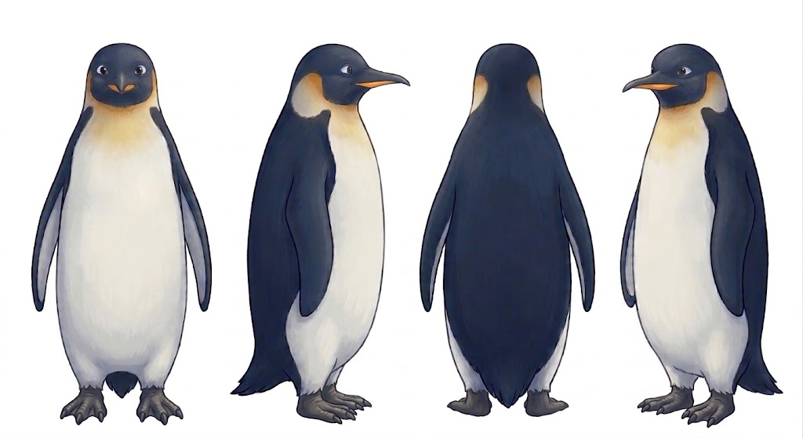 | 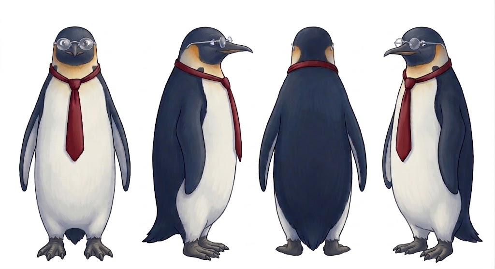 |

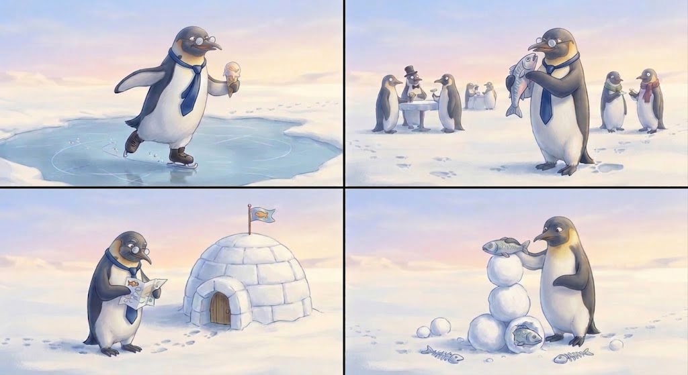

Rebuilding that design in code went a long way (smooth shading, navy and cream, a golden ear crescent, a chest wash, a tail, eye highlights), but it kept looking like a plastic version of a painting. A shape spun from a profile line can't carry the feathers, outlines and expressive head of an illustration.

### The decision

Three options were on the table: an AI image-to-3D model, a 3D artist, or **Kálmán as a 2D illustration**. Raymond chose 2D, for the whole site: his own design, exactly as drawn, animated as a **cut-out figure** (separate layers for body, head, flippers, feet, tail, tie and glasses, moved in code). It is also lighter and faster than 3D, which helps on phones and in Lighthouse.

### What it taught us

- **Decide the look with the right tool.** Sliders are good for tuning; they are a poor way to *design* a character. An image generator got to Raymond's Kálmán in minutes.
- **A good process makes a change of direction cheap.** The 3D work stays on its branch, the general improvements (per-page budgets, the production-build check, the dev-only route) move on, and the README, planning log and specs record why.

---

## 2026-10-26 · Kálmán's rig: a paper puppet in code

### The plan

The illustrations don't exist yet, but everything that moves them can be built now. So the first 2D change (`kalman-rig`) builds the *rig* with placeholder shapes, and the real art drops in later as data. The animations follow in a separate change, so the rig can be judged first. Raymond chose that order.

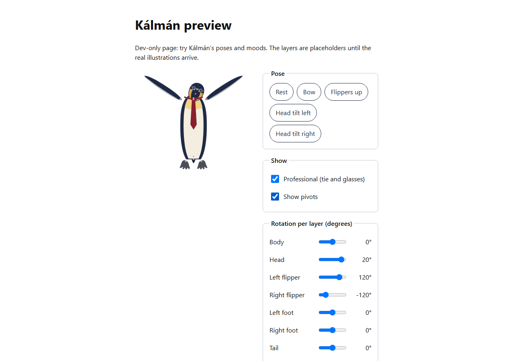

### How it works

- **The rig is data.** `rig.json` lists the nine layers (body, head, two flippers, two feet, tail, tie, glasses): which image, where it sits on the artboard, where it turns, which layer it hangs from, the drawing order and how far it may turn. `poses.json` holds the named poses as "turn this, shift that" from rest.
- **One function does the maths.** `resolvePose()` turns rig + pose into one transform matrix per layer. A child moves with its parent's movement from rest, so the glasses follow the head and everything follows the body.
- **Flat SVG instead of nested groups.** Letting the browser nest the layers would have been less code, but in SVG a child is always drawn in front of its parent, and the far flipper must be able to sit behind the body.
- **He is in the HTML.** The figure is drawn at build time, so he shows without JavaScript, and the fallback stills later are the same component in another pose.
- **The preview** at `/playground/` has a button per pose, a mood switch for the tie and glasses, pivot markers, a slider per layer and **Copy pose**. It loads 4.4 KB of JavaScript.
- **A layer guide with prompts** (`docs/kalman-layers.md`) lists the nine images to make, the rules that make them fit, and a prompt per layer for the image generator.

### What went wrong, and what it taught us

- **The raised flippers stuck out of the picture.** Kálmán's flippers are long (as on the sheet), and the first artboard was cut to his standing silhouette. A screenshot showed it straight away; the artboard became wider and the "flippers up" pose a little lower. Lesson: size the drawing area for the widest pose, not for the rest pose.
- **A front-view bow is subtle.** From the front, bowing mostly means the head and body dropping a little. The real bow will probably use the side view, in the animations change.
- **Small tooling surprises:** an `<output>` element counts as a status message for screen readers (and for the tests); SVG has no reliable `hidden` attribute; Node needs an extra attribute to import JSON; and Astro allows only one preview server per project.

---

## 2026-10-26 · From a placeholder penguin to Raymond's own Kálmán

### What happened

The rig worked, but the penguin on it didn't: flat shapes drawn in code, which looked nothing like Raymond's design. His verdict was to start Phase 1 over. Before throwing anything away, one quick test showed where the problem really was: cutting the front view of his own design sheet into the nine layers. With his art on the same rig, he loved it. The rig was never the problem; the penguin drawn in code was.

Then the design itself moved on: Raymond chose a new final design (slate grey, a purple patterned tie, round black glasses, big round goofy eyes) and made it with Gemini, as large separate images instead of one small sheet.

| Goofy | Professional (an edit of the goofy image) |
|---|---|
| 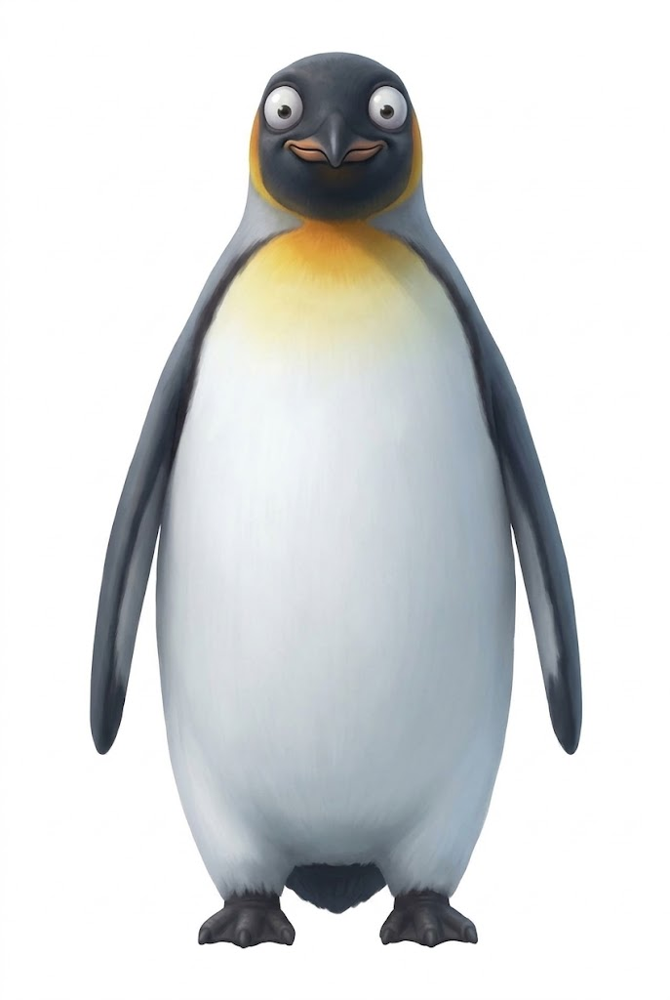 | 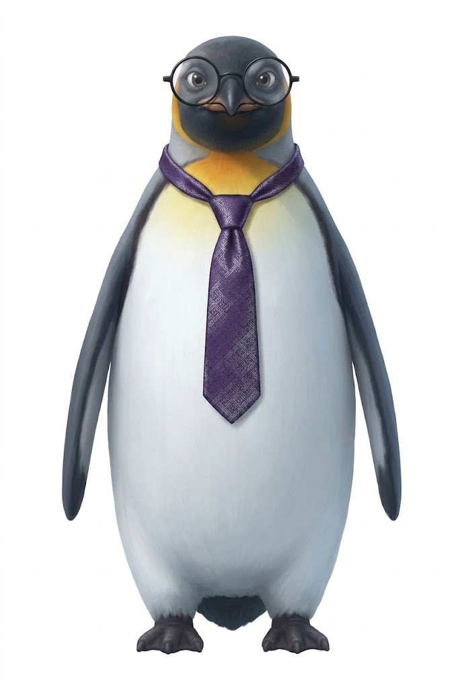 |

### How the images become a figure

- **The edit trick:** the professional image is an edit of the goofy one, so the two line up pixel for pixel. Their difference is exactly the tie, the glasses and the calmer eyes, which become the tie and glasses layers. No separate drawing per accessory needed.
- **A script cuts everything** (`npm run cut:kalman`): the nine layers, the front views and the turntable views, plus `rig.json` and `turntable.json`. The same images always give the same files.
- **Turning around:** four more views (¾ front, side, ¾ back, back), each with a professional edit, and the other side mirrored: eight angles. In between, the view narrows and the next one fades in on top. Raymond asked about a real 3D model too; Kálmán stays 2D (free AI plans can't export, and 3D would bring back Three.js and clash with the painted 2D site).
- **Spinning** the whole figure is a slider in the preview too.

### What went wrong, and what it taught us

- **Try the real art before judging the code.** A placeholder that looks bad makes good code look bad. Ten minutes of cutting Raymond's own image answered the question that a restart would not have.
- **Joints are where cut-outs show their seams.** Every fix was about two layers meeting: the head needed a soft fade into the neck; the flippers first took a strip of the body along when raised, then left the flipper's outline behind on the body, and finally a hairline seam showed at rest. The answer: cut exactly at the real gap below the shoulder, share no pixel there, and let the flipper reach a little under the body above it.
- **AI views drift in colour.** The back views came out lighter and darker than the front; the script now matches every view's plumage tone to the front view, and puts his feet on the same ground line.
- **Small tooling lessons:** SVG children with `visibility="visible"` still show inside a hidden group (use `display`); two attributes with the same name on different elements break test selectors; and a dev server on the test port quietly turns e2e tests into tests of the dev server.

---

## 2026-10-27 · Kálmán moves: the animations

### The plan

The last part of Phase 1: idle, bow, head-follow, dive, swim and launch, each judged by Raymond in the preview. Raymond approved GSAP, chose a second, side-view figure for diving and swimming, and asked for play buttons plus an idle loop.

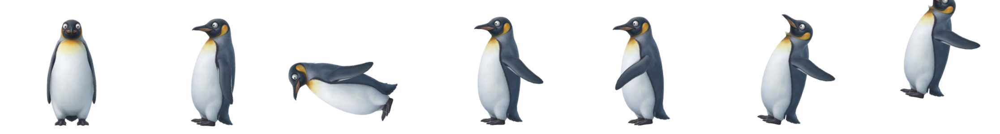

### How it works

- **Animations are data.** `animations.json` lists keyframes: a pose at a moment, with an easing towards the next one. The bow is rest → bow → hold → rest in 1.8 s. Raymond can tune timing and poses without touching code.
- **GSAP is only the clock.** One tween moves a time value from 0 to the animation's length; on every frame our own `samplePose()` blends the two keyframes around that time (through GSAP's easing curve) and the figure draws the result. The maths is tested without GSAP or a browser.
- **A side figure** for the movements that read from the side. Raymond made three Gemini images: the side view, its professional edit, and an edit *without* the near flipper. The body comes from that last one, so a swinging flipper shows painted body underneath instead of a ghost of itself.
- **The preview** got a play button per animation, an idle loop (off with reduced motion), a scrub slider to hold any moment still, head-follow with the pointer, and a front/side switch. With GSAP it loads 36 KB of JavaScript, within the 50 KB budget.

### What went wrong, and what it taught us

- **A difference image isn't always clean.** For the side flipper, the difference with the flipper-less edit should have been the flipper. But Gemini's edit also changed the feathers around it, so the outline never closed. Tracing the flipper's outline once, as a polygon, was simpler and exact.
- **Turn around the middle, not the feet.** The side body first turned around his feet, so a dive tipped him out of the frame. Turning around the middle of the body keeps him on the stage.
- **Rotating isn't always the right move.** To make him point up for the launch, turning the whole body tipped him onto his back. A launch is an upright body with the head tilted back: the pose had to tell the story, not the angle.
- **Tests that move the page.** On a phone, switching a control below the figure scrolled the page, so a drag test missed Kálmán entirely. Tests now scroll him back into view first.
- **Wait for a change, don't sleep for one.** "The idle loop plays" checked the time once, waited 400 ms and checked again. On a busy CI machine WebKit skipped frames for that long, so the test failed although the loop played. It now polls until the time moves (up to 5 s); retries stay off, so a stuck animation still fails.
- **Tooling:** Claude Code's auto mode depends on a server-side safety check per shell command; when that check was down for a while, work went on with file edits and continued in normal permission mode.

Raymond judged the animations in the preview and approved them. With that, Phase 1 is done: Kálmán exists, is drawn from Raymond's own art, and moves.

## 2026-10-27 · Kálmán comes alive: follow-through, squash and stretch

### The plan

After Phase 1 was merged, Raymond looked again: the idle loop moved naturally, but the bow wasn't deep enough and the dive, the swim and the launch looked *static*. The data showed why: every layer started and stopped together on the same keyframes, nothing overshot or settled, the crouch was tiny, the dive slid in a straight line, the feet never moved, he swam upright, and the bow from the front only slid his head down 26 px. A follow-up change, `kalman-animation-feel`, still under Phase 1.

Raymond gave the feeling of each animation (a polite butler's bow; a dive that is a little goofy but natural, face first; an elegant swim, distracted by fish; a professional launch with a goofy landing) and stills from nature films. The stills stay out of the repo (other people's footage, a `references/` folder in `.gitignore`); what they showed is written down in the design. Two things in them changed the plan: a real bow barely moves the body (the head folds down), and penguins swim *horizontally*, like torpedoes.

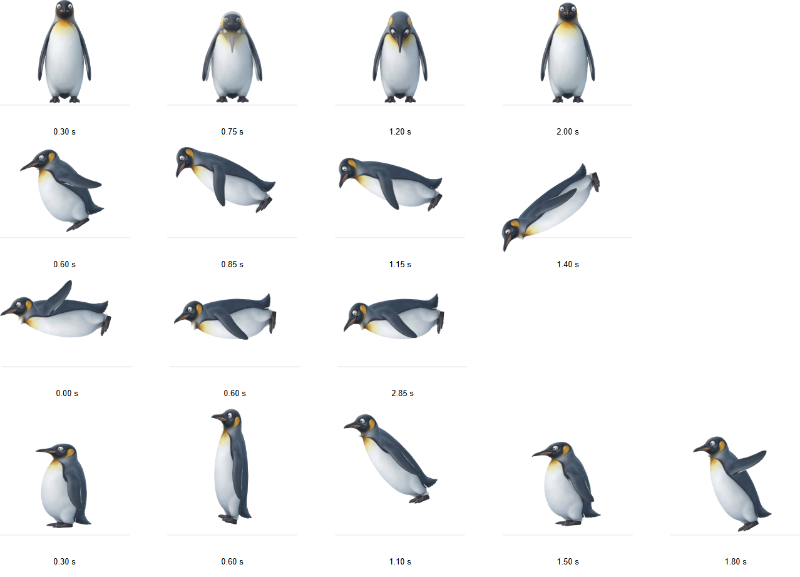

### How it works

- **Squash and stretch.** A layer can stretch around its pivot: 0.9 is 10% shorter and 1 / 0.9 wider, so the area stays the same, like a rubber ball. Children follow, so the head stays on a squashed body.
- **Follow-through as a time shift.** A layer with a lag shows where the animation was a moment ago: the tail trails 0.12 s behind the body. Still a pure function of time, so scrubbing and the tests stay exact.
- **Overshoot, clamped.** GSAP's `back` easings go slightly past the target and settle; every pose is clamped to the rig's ranges before it is drawn.
- **A drawn bow.** From the front a bow can't be made by turning flat layers, so Raymond made a drawing of the bow (two Gemini edits of the front view, goofy and professional). At the deepest moment it cross-fades in over the layers.
- **Tested against the real data.** Every scenario ("the swim lies horizontally", "he lands squashed") is a unit test that samples the repo's animations exactly as the player draws them.

### What went wrong, and what it taught us

- **Gemini redraws more than you ask.** The first bowed images changed the whole upper body and gave him stern, realistic eyes. The lower half lined up, so the bow became a whole drawn pose instead of a new head; a second round with "keep his big round goofy eyes" gave Kálmán back.
- **Feet that overlap can't be cut apart cleanly.** Turning the side feet showed a straight cut line, a white wedge of belly and ghost outlines. Cutting the feet from their dark pixels only, with a soft ankle, keeping a fading strip of leg on the body, and giving both feet one pivot fixed it; ±20° instead of ±30°.
- **A 50/50 cross-fade is see-through.** Two pictures at 50% each cover only 75%. Fading the drawing in over solid layers first, then the layers out under the solid drawing, keeps him solid.
- **Tip the body, and the bill tips along.** Lying horizontally, his bill pointed at the floor. Turning the head back up to 70° makes him swim bill first.
- **Film strips before the preview.** Rendering a row of frames of each animation (with the same maths the player uses) showed these problems before anyone had to watch them.

### Second and third round: Raymond's eye

Raymond tried each round in the preview, and every round found what still frames had hidden.

- **Eyes that follow.** "Only the head moves": the pupils became their own layers, cut from two more Gemini edits without pupils, with a shift limit so they stay in the eye. They look first, then the head, then the body (overlap again).
- **Knees.** Penguins stand on bent knees hidden inside the body. A pose can plant the feet: they move with the body but never go into the ground, and stay level when he leans. The first version kept the feet where they stood at rest, and they came loose as soon as he leaned.
- **A drawn swimming figure.** Tipping the side figure to swim bent its neck awkwardly; Raymond drew Kálmán as a torpedo, and that became a third figure with its own flipper.
- **A belly landing** after the launch, as in the nature stills: land, slide, push up, wobble, stand.
- **Smooth curves instead of pieces.** "Woody": every piece between two poses eased to a stop, so he paused at each pose mid-movement. Now every value follows one monotone curve through all its poses and only slows where a movement turns around.
- **Strict tests find real bugs.** Tightening a test I had loosened showed his belly sank 40 units into the ice at the landing.
- **Linux isn't Windows.** In CI, "Swimming" stuck out 6 px on a 360 px phone because Linux fonts are a little wider; the figure options now wrap.

Raymond approved the result. The agreement that he must be able to explain every line was dropped along the way: the highest quality and user experience come first.

## 2026-10-28 · Phase 2 starts: the dive

### The plan

Phase 2 is split into small changes; the first, `dive-scroll`, lays the foundation everything else in the phase builds on: the home page becomes the dive. Scrolling is diving, from the ice down to 564 m (an emperor penguin's record) and back up to Contact on the ice. Six sections with placeholder text in three languages, a depth gauge that is also the navigation, water that darkens with depth, and Kálmán diving along.

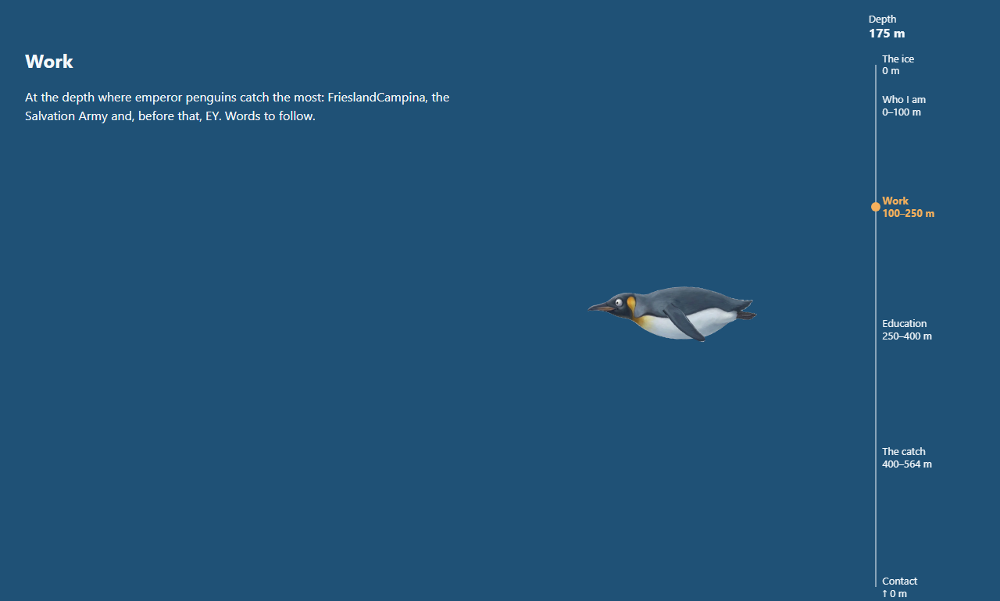

### How it works

- **Scrolling stays the browser's own.** No scroll hijacking: the page is long HTML, and a script only reads the scroll position, at most once per frame. Each section's start is an anchor with its depth; in between the depth is a straight line, and after The catch it counts back to 0 m (the ascent).
- **Every decision is a pure function** in `src/lib/dive.ts`: depth from scroll, colour from depth, and what Kálmán does. His animations are never scrubbed by the scroll: a small state machine (on the ice, diving, swimming, launching, ashore) only starts an animation when the state changes, so the dive and the launch play as whole performances.
- **Colour with contrast built in.** The water blends between colour stops in OKLab, so it stays a clean blue instead of turning muddy. A unit test checks text and accent at every metre from 0 to 564 m.
- **The express dive.** Every gauge entry is a plain link; with JavaScript it becomes a 0.8 s dive, with Kálmán swimming at double speed, or an instant jump with reduced motion. Focus lands on the heading.
- **The still dive.** With reduced motion, Save-Data or no JavaScript, every section gets its own water colour and a still Kálmán in a fitting pose.

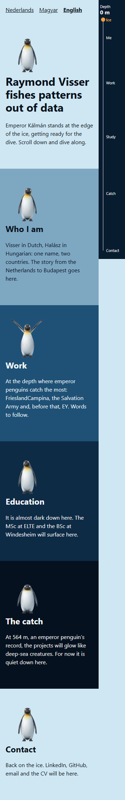

### What went wrong, and what it taught us

- **1.6 MB of penguin.** The figure drew every image it had (turntable views, drawn poses) as large PNGs. Now pages draw only what they use, as WebP at the size it is shown: the front figure is about 90 KB, and the side and swimming figures load after the page.
- **The security policy blocks inline styles,** so per-section colours can't go in `style="…"`. They are written at build time into a small stylesheet, `/dive.css`, from the same functions.
- **No fixed accent survives every depth.** On mid-tone water no golden orange reaches 4.5:1 against the background, so the accent (and the text) is lightened or darkened just enough per depth.
- **The size check counted too little.** Vite writes lazy imports with backticks, which the budget script didn't recognise, so the home pages looked like 4 KB instead of 40 KB.
- **A jump Lighthouse saw and we didn't.** CI scored the home pages 78: the page painted in the fallback layout, then the mode script switched to full and the whole dive jumped (a layout shift of 0.58, in three runs out of five). The mode is now decided by a tiny classic script in `<head>`, before the first paint, kept in step with the tested function by a unit test that runs the real file. Back to 98–99.
- **Same specificity, wrong winner.** On a phone, Kálmán's own `height: auto` beat the stage's sizing and he spilled over the language links, so they couldn't be tapped. The e2e tests in mobile browsers caught it.

### Raymond's eye

Raymond's verdict after trying it: Kálmán took up too much space. He should be a guide, not take the attention away from the content. The stage went from 30rem to 18rem (22% of a phone screen instead of 30%), and the sections got shorter, about a screen each, so there is less empty water until the real content and the fish arrive.

